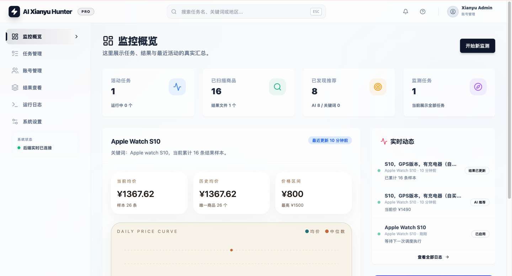
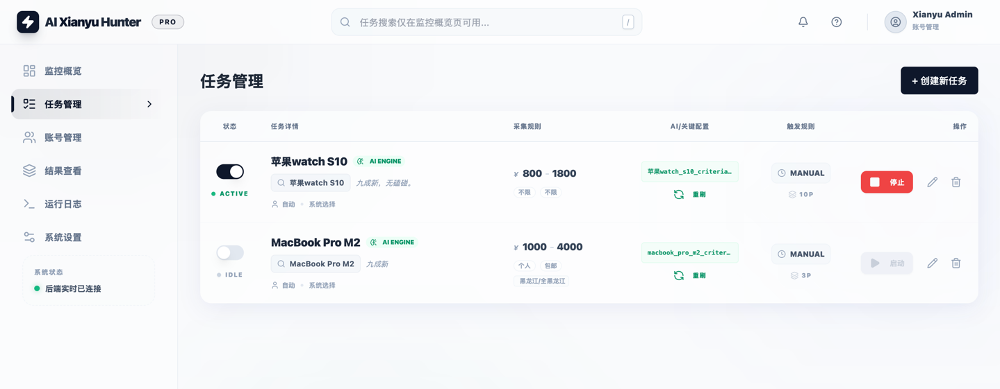
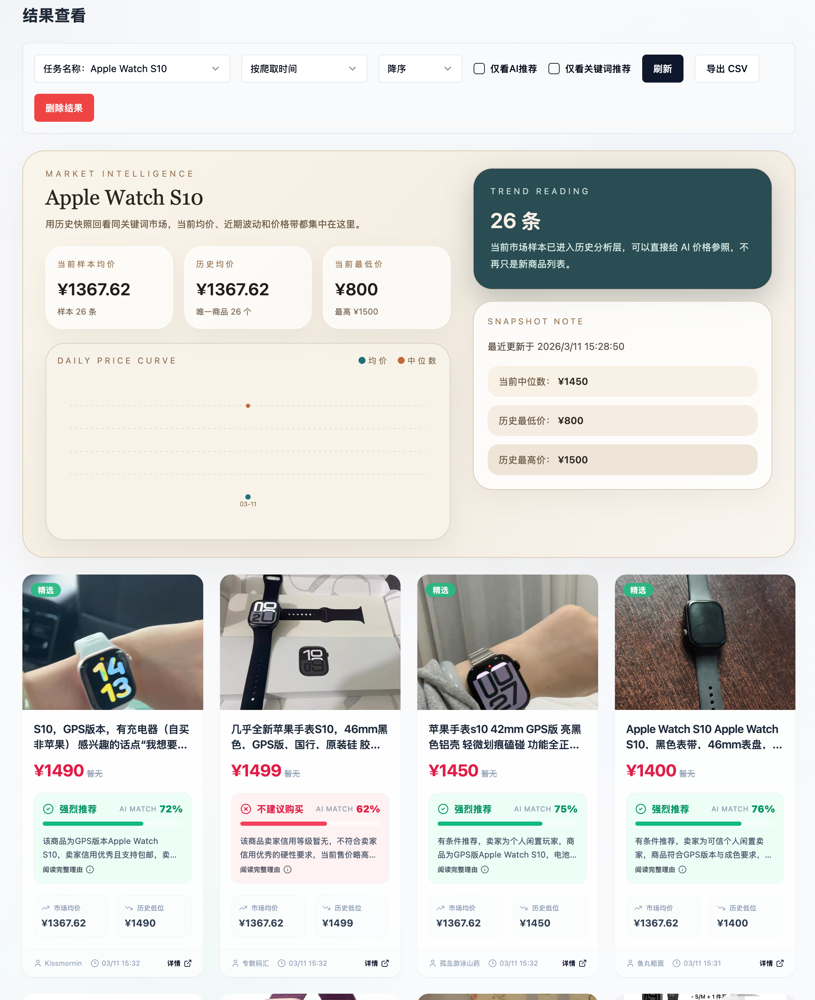
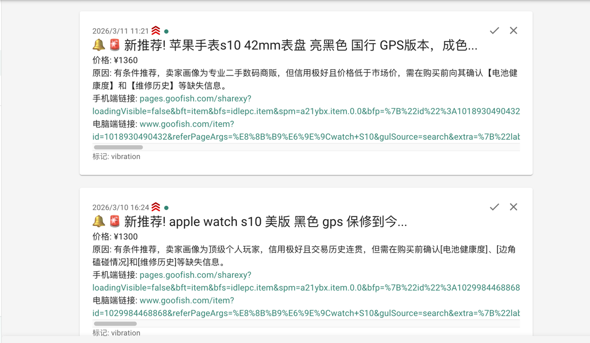
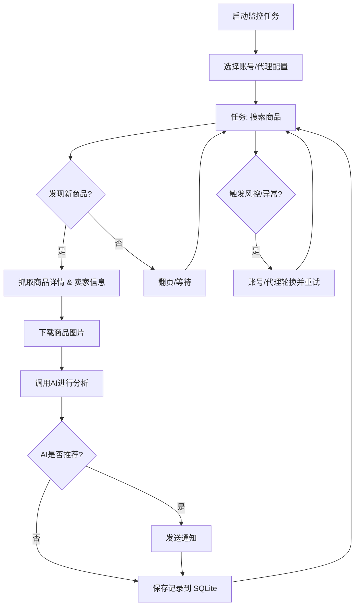

# 闲鱼智能监控系统

[中文] ｜ [English](README_EN.md)

基于 Playwright 和 AI 的闲鱼多任务实时监控，提供完整的 Web 管理界面。

> 本仓库基于开源项目 [Usagi-org/ai-goofish-monitor](https://github.com/Usagi-org/ai-goofish-monitor) 二次开发，
> 在原闲鱼监控的基础上新增了**孔夫子旧书网监控**、**AI Token 用量监测**、平台级推送开关，以及 Windows 本地启动脚本等改动，详见文末「更新日志」。


## 核心特性

- **Web 可视化管理**: 任务管理、账号管理、AI 标准编辑、运行日志、结果浏览、Token 用量监测
- **AI 驱动**: 自然语言创建任务，多模态模型深度分析商品
- **多平台监控**: 闲鱼与孔夫子旧书网双平台任务并存，抓取、账号与推送策略互相隔离
- **多任务并发**: 独立配置关键词、价格、筛选条件和 AI Prompt
- **高级筛选**: 包邮、新发布时间范围、省/市/区三级区域筛选
- **即时通知**: 支持 ntfy.sh、企业微信、PushPlus、Bark、Telegram、Webhook 等多渠道
- **定时调度**: 支持 Cron 配置周期性任务
- **账号与代理轮换**: 多账号管理、任务绑定账号、代理池轮换与失败重试
- **Docker 部署**: 一键容器化部署

## 截图






## 🐳 Docker 部署（推荐）

```bash
git clone https://github.com/weiyuzzz/ai-goofish-monitor && cd ai-goofish-monitor
cp .env.example .env
vim .env # 填写相关配置项
docker compose up -d
docker compose logs -f app
docker compose down
```

如果镜像无法访问或下载速度慢，可尝试使用加速：
```bash

docker pull ghcr.nju.edu.cn/usagi-org/ai-goofish:latest
docker tag ghcr.nju.edu.cn/usagi-org/ai-goofish:latest ghcr.io/usagi-org/ai-goofish:latest
docker compose up -d

```

- 默认 Web UI 地址：`http://127.0.0.1:8000`
- Docker 镜像已内置 Chromium，无需宿主机额外安装浏览器。
- 官方镜像地址：`ghcr.io/usagi-org/ai-goofish:latest`
- 更新镜像：`docker compose pull && docker compose up -d`
- 如果你修改了 `.env` 中的 `SERVER_PORT`，请同步更新 `docker-compose.yaml` 里的端口映射。
- `docker-compose.yaml` 默认会把 SQLite 主库挂载到 `./data:/app/data`，数据库文件默认为 `data/app.sqlite3`
- 目前默认持久化这些目录：
    - `data/`  SQLite 主存储（任务、结果、价格历史、Token 用量）
    - `state/`  登录状态 cookie 文件
    - `prompts/`  任务提示词
    - `logs/`  运行日志
    - `images/`  商品图片与任务临时图片目录
    - `config.json`、`jsonl/`、`price_history/`  首次升级到 SQLite 时用于兼容导入的旧数据源

### 数据存储与迁移

- 当前在线主存储为 SQLite，默认路径 `data/app.sqlite3`
- 可通过环境变量 `APP_DATABASE_FILE` 自定义数据库路径；Docker 默认设置为 `/app/data/app.sqlite3`
- 应用启动时会自动建库建表，并尝试从旧的 `config.json`、`jsonl/`、`price_history/` 导入一次历史数据
- `state/`、`prompts/`、`logs/`、`images/` 仍然是文件系统目录，不在 SQLite 中
- 商品图片会临时落到 `images/task_images_<task_name>/`，任务结束后默认会清理
- 首次升级完成并确认 `data/app.sqlite3` 中数据正确后，可视部署方式决定是否继续保留旧的 `config.json`、`jsonl/`、`price_history/` 挂载

### 最少配置

| 变量 | 说明 | 必填 |
|------|------|------|
| `OPENAI_API_KEY` | AI 模型 API Key | 是 |
| `OPENAI_BASE_URL` | OpenAI 兼容接口地址 | 是 |
| `OPENAI_MODEL_NAME` | 支持图片输入的模型名称 | 是 |
| `WEB_USERNAME` / `WEB_PASSWORD` | Web UI 登录账号密码，默认 `admin/admin123` | 否 |

其余配置见下方“配置说明”。


### 第一次使用

1. 打开默认 Web UI `http://127.0.0.1:8000` 并登录。
2. 进入“闲鱼账号管理”，使用 [Chrome 扩展](https://chromewebstore.google.com/detail/xianyu-login-state-extrac/eidlpfjiodpigmfcahkmlenhppfklcoa) 导出并粘贴闲鱼登录态 JSON。
3. 登录态文件会保存到 `state/` 目录，例如 `state/acc_1.json`。
4. 回到“任务管理”，创建任务并绑定账号后即可运行。

### 创建第一个任务

- `AI判断`：填写“详细需求”，提交后会弹出独立进度弹窗，后台异步生成分析标准。
- `关键词判断`：填写关键词规则，任务会直接创建，不经过 AI 生成流程。
- `区域筛选`：已改为省 / 市 / 区三级选择器，数据基于闲鱼页面抓取快照内置。


## 用户使用说明

<details>
<summary>点击展开 Web UI 功能说明</summary>

### 任务管理

- 支持 AI 创建、关键词规则、价格范围、新发布范围、区域筛选、账号绑定、定时规则。
- AI 任务创建是后台 job 流程，提交后会打开单独的进度弹窗。
- 区域筛选会显著缩小结果集，默认留空。

### 账号管理

- 支持导入、更新、删除闲鱼账号登录态。
- 每个任务可指定账号，也可不绑定并交给系统自动选择。

### 结果查看与运行日志

- 结果页和导出功能现在从 SQLite 查询，不再直接扫描 `jsonl` 文件。
- 日志页按任务展示运行过程，便于排查登录态失效、风控和 AI 调用问题。

### Token 用量监测

- 页面位置：左侧导航“Token 监测”（`/tokens`），数据来自 SQLite 的 `ai_token_usage` 表。
- 每次 AI 调用（商品分析、AI 标准生成、连接测试）都会记录输入 / 输出 token，可查看当日消耗、今日分时柱状图、近 7 / 14 / 30 天趋势、模型与来源分布，以及最近 20 条调用明细。
- 说明：用量从该功能上线后开始记录，历史调用无法追溯统计。

### 系统设置

- 可查看系统状态、编辑 Prompt、调整代理与轮换相关配置。

</details>


## 📚 孔夫子旧书网监控

左侧导航新增一级菜单「孔夫子监控」（`/kongfz`），与闲鱼任务完全隔离、可同时运行。

### 工作方式：滚动窗口 = 站点「最新上架」排序

- 每个监控任务配置一个关键词和「监控最新条数 N」（1-200）。
- 每次运行按站点**最新上架排序**抓取，窗口内始终保存**最新 N 条仍在售**的商品：
  - 有新商品上架 → 进入窗口，末尾商品被挤出并**直接移除**；
  - 有商品下架 / 售出 → 自动跳过，由后面的商品**补位**。
- 因此监控页面看到的内容，与孔夫子站点「最新上架」的前 N 条保持一致。
- 抓取不完整（接口异常 / 登录墙）时会**跳过窗口同步**，不会误删任何本地记录。

### 账号配置栏

孔夫子搜索接口需要登录态，页面顶部提供账号配置：

- **扫码登录**：在服务器本机弹出浏览器窗口，用微信 / QQ / 孔网账号扫码，登录态保存到 `state/kongfz_*.json`。
- **导入登录态**：Docker 等无法弹出浏览器的环境，可直接粘贴 Playwright `storage_state` JSON。
- **校验有效性 / 删除**：随时检查登录态是否过期。

> 说明：未配置登录态时可以游客模式短期试抓（「试抓预览」），但请求量上来后接口会返回
> `errType=102 请登录后再进行访问`，请务必配置登录态。

### 推送开关（闲鱼 / 孔夫子互相独立）

「系统设置 → 消息推送」顶部新增**平台推送开关**：

- 只打开闲鱼 → 只推送闲鱼；
- 只打开孔夫子 → 只推送孔夫子；
- 两个都打开 → 两个都推送（各自独立的通知内容与触发条件）。

孔夫子默认**任何新上架商品都推送**，不经过 AI 判定；可在任务中额外开启「移除时推送」。

### 命令与配置

```bash
# 运行所有启用的孔夫子任务
python spider_kongfz.py

# 只运行指定任务（调度器调用）
python spider_kongfz.py --task-name "孔网-红楼梦"

# 扫码登录（也可通过 Web 界面触发）
python kongfz_login.py --name kongfz_1
```

限速与场景相关环境变量：`KONGFZ_REQUEST_INTERVAL`、`KONGFZ_REQUEST_JITTER`、
`KONGFZ_REQUEST_TIMEOUT`、`KONGFZ_REQUEST_RETRIES`、`KONGFZ_PROXY`、`KONGFZ_LIST_SCENE`、
`KONGFZ_USER_AREA`，详见 `.env.example`。

> ⚠️ 合规提示：`search.kongfz.com/robots.txt` 内容为 `Disallow: /`。请仅将本功能用于个人学习与研究，
> 保持较低请求频率，并遵守《免责声明》。


## 开发者开发

### 环境要求

- Python 3.10+
- Node.js + npm（本地验证 `Node v20.18.3` 可完成前端构建）
- Playwright CLI 与 Chromium，首次运行前建议执行 `python3 -m pip install playwright && python3 -m playwright install chromium`
- Chrome / Edge 浏览器（Linux 环境也可使用 Chromium；`start.sh` 会先检查浏览器是否存在）

```bash
git clone https://github.com/weiyuzzz/ai-goofish-monitor
cd ai-goofish-monitor
cp .env.example .env
```

### 一键启动

```bash
chmod +x start.sh
./start.sh
```

`start.sh` 会先检查 Playwright CLI 和浏览器前置条件；在前置条件满足后自动安装项目依赖、构建前端、复制构建产物并启动后端。

### Windows 本地启动

```powershell
# 首次：创建虚拟环境并安装依赖
python -m venv .venv
.venv\Scripts\python.exe -m pip install -r requirements.txt

# 前端构建（产物会复制到根目录 dist\）
cd web-ui; npm install; npm run build; cd ..

# 启动后端（自动读取 .env 中的 SERVER_PORT）
.\start.ps1
```

`start.ps1` 会依次检查 `.venv`、`dist\index.html`、`.env` 是否存在，再用项目内置虚拟环境启动 FastAPI，默认访问 `http://127.0.0.1:8000`。

### 登录态工具

```bash
# 闲鱼：弹出真实浏览器扫码登录，登录态写入 state/<账号名>.json
.venv\Scripts\python.exe xianyu_login.py --name acc1
# 或
.venv\Scripts\python.exe xianyu_login.py --name acc1 --timeout 900

# 孔夫子：扫码登录
.venv\Scripts\python.exe kongfz_login.py --name kongfz_1
```

登录态统一保存在 `state/`，也可在 Web UI「账号管理」里直接粘贴 Playwright `storage_state` JSON 或校验有效性。

### 手动启动

```bash
# 后端
python -m src.app
# 或
uvicorn src.app:app --host 0.0.0.0 --port 8000 --reload

# 前端
cd web-ui
npm install
npm run dev
```

- FastAPI 启动时会自动初始化 SQLite，并在首次启动时尝试导入旧的 `config.json/jsonl/price_history`
- `spider_v2.py` 默认从 SQLite 读取任务；只有显式传入 `--config <path>` 时才会走 JSON 配置兼容模式
- 默认数据库路径为 `data/app.sqlite3`
- Vite 开发服务器会将 `/api`、`/auth`、`/ws` 代理到 `http://127.0.0.1:8000`。
- `npm run build` 先生成 `web-ui/dist/`，`start.sh` 再复制到仓库根目录 `dist/`。
- FastAPI 负责提供根目录 `dist/index.html` 和 `dist/assets/`。
- `./start.sh` 默认输出访问地址 `http://localhost:8000` 和 API 文档 `http://localhost:8000/docs`。

### 测试与校验

```bash
PYTEST_DISABLE_PLUGIN_AUTOLOAD=1 pytest
cd web-ui && npm run build
```

### 任务创建 API

<details>
<summary>点击展开 API 行为说明</summary>

- `POST /api/tasks/generate`
  - `decision_mode=ai`：返回 `202` 和 `job`，需要继续轮询进度。
  - `decision_mode=keyword`：直接返回已创建任务。
- `GET /api/tasks/generate-jobs/{job_id}`：查询 AI 任务生成进度。
- `POST /auth/status`：校验 Web UI 登录凭据。

</details>

## 配置说明

<details>
<summary>点击展开常用配置项</summary>

### AI 与运行时

- `OPENAI_API_KEY` / `OPENAI_BASE_URL` / `OPENAI_MODEL_NAME`：AI 模型接入必填项。
- `PROXY_URL`：为 AI 请求单独指定 HTTP/SOCKS5 代理。
- `RUN_HEADLESS`：是否以无头模式运行爬虫；Docker 中应保持 `true`。
- `SERVER_PORT`：后端监听端口，默认 `8000`。
- `LOGIN_IS_EDGE`：本地环境可切换为 Edge 内核；Docker 镜像未内置 Edge，容器内会固定使用 Chromium。
- `PCURL_TO_MOBILE`：是否将 PC 商品链接转换为移动端链接。

### 通知

- `NTFY_TOPIC_URL`
- `GOTIFY_URL` / `GOTIFY_TOKEN`
- `BARK_URL`
- `WX_BOT_URL`
- `TELEGRAM_BOT_TOKEN` / `TELEGRAM_CHAT_ID` / `TELEGRAM_API_BASE_URL`
- `WEBHOOK_*`

### 代理轮换与失败保护

- `PROXY_ROTATION_ENABLED`
- `PROXY_ROTATION_MODE`
- `PROXY_POOL`
- `PROXY_ROTATION_RETRY_LIMIT`
- `PROXY_BLACKLIST_TTL`
- `TASK_FAILURE_THRESHOLD`
- `TASK_FAILURE_PAUSE_SECONDS`
- `TASK_FAILURE_GUARD_PATH`

完整示例见 `.env.example`。

</details>

## Web 界面认证

<details>
<summary>点击展开认证说明</summary>

- Web UI 当前使用登录页收集账号密码，并通过 `POST /auth/status` 校验。
- 登录成功后，前端会在浏览器本地保存登录状态，用于路由守卫和 WebSocket 初始化。
- 默认账号密码为 `admin/admin123`，生产环境请务必修改。

</details>

## 🚀 工作流程

下图描述了单个监控任务从启动到完成的核心处理逻辑。主服务运行于 `src.app`，按用户操作或定时调度启动一个或多个任务进程。



## 常见问题

<details>
<summary>点击展开常见问题</summary>

### AI 任务创建为什么不是立即完成？

AI 模式会先生成分析标准，再创建任务。现在该流程已改为后台 job，提交后会显示独立进度弹窗，避免表单长时间卡住。

### 区域筛选为什么默认建议留空？

区域筛选会显著减少搜索结果，适合明确只看某个区域的场景。若你先验证整体市场，建议先不填。

### 本地页面打开后提示前端构建产物不存在？

说明根目录 `dist/` 缺失。可直接执行 `./start.sh`，或先在 `web-ui/` 里执行 `npm run build`，再确认构建产物已复制到仓库根目录。

### `./start.sh` 为什么提示缺少 Playwright 或浏览器？

这是脚本的前置检查。请先安装 Playwright CLI 与 Chromium，并确保系统中可用 Chrome / Edge（Linux 环境也可用 Chromium），然后重新执行 `./start.sh`。

</details>


## 更新日志

<details>
<summary>点击展开更新日志</summary>

### 2026-11

- 新增**孔夫子旧书网监控**（`/kongfz`）：按「最新上架」排序的滚动窗口（关键词 + 最新 N 条）、扫码 / 导入登录态、独立的推送开关；新增 `spider_kongfz.py`、`kongfz_login.py` 与 `src/kongfz/` 模块。
- 新增**AI Token 用量监测**（`/tokens`）：记录每次 AI 调用的输入 / 输出 token，提供今日消耗、分时柱状图、近 7 / 14 / 30 天趋势与调用明细。
- 新增平台级推送开关：闲鱼与孔夫子推送互相独立，可分别开启。
- 新增 `xianyu_login.py` 扫码登录工具、`start.ps1` Windows 本地启动脚本与 `.env.example` 中孔夫子相关配置项。
- 测试补充：孔夫子解析 / 账号 / 伪装 / 窗口、Token 用量、任务停止、运行报告等用例。

</details>

## 致谢

<details>
<summary>点击展开致谢内容</summary>

本项目在开发过程中参考了以下优秀项目，特此感谢：

- [superboyyy/xianyu_spider](https://github.com/superboyyy/xianyu_spider)

以及感谢LinuxDo相关人员的脚本贡献

- [@jooooody](https://linux.do/u/jooooody/summary)

以及感谢 [LinuxDo](https://linux.do/) 社区。

以及感谢 ClaudeCode/Gemini/Codex 等模型工具，解放双手 体验Vibe Coding的快乐。

</details>


## 注意事项

<details>
<summary>点击展开注意事项详情</summary>

- 请遵守闲鱼的用户协议和robots.txt规则，不要进行过于频繁的请求，以免对服务器造成负担或导致账号被限制。
- 本项目仅供学习和技术研究使用，请勿用于非法用途。
- 本项目采用 [MIT 许可证](LICENSE) 发布，按"现状"提供，不提供任何形式的担保。
- 项目作者及贡献者不对因使用本软件而导致的任何直接、间接、附带或特殊的损害或损失承担责任。
- 如需了解更多详细信息，请查看 [免责声明](DISCLAIMER.md) 文件。

</details>

## Star History

[](https://www.star-history.com/#Usagi-org/ai-goofish-monitor&Date)


